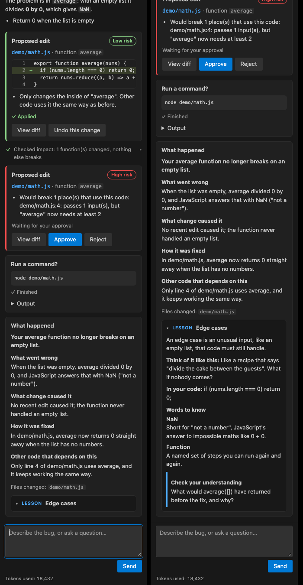

# DebugWise

**An AI debugger that teaches.** DebugWise is a VS Code extension for people who build with code but never formally learned it. It finds and fixes bugs with your approval, then explains in plain English what went wrong and teaches the programming concept behind it, so each bug leaves you understanding your code a little better.

<p align="center">
  
</p>

## Why

AI coding tools can fix bugs, but they leave non-programmers with a fixed file and no idea what happened. DebugWise is built around two goals:

1. **Debug safely.** Nothing changes without your approval, and every change shows its risk and can be undone.
2. **Teach.** Every fix ends with a short lesson tied to your own code: the concept, an everyday analogy, key terms and a question to check your understanding.

## What it does

- **Chat in the sidebar.** Describe a bug in your own words, e.g. "my total shows NaN".
- **Shows its work.** Activity rows show each file it reads (and which lines), files it lists and checks it runs. File names are clickable.
- **Edit cards with a risk level.** Before any file is written you see the function being changed, an inline diff and a **Low / Medium / High** risk rating with reasons, plus a button to open VS Code's side-by-side diff. The file is only written after you click **Approve**.
- **Command cards.** Every shell command is shown exactly as it will run and needs your approval.
- **Undo per edit.** Each applied edit has an **Undo this change** button.
- **Plain-English explanation:** what went wrong, what change caused it, how it was fixed and what other code depends on it.
- **A Lesson after every fix,** in a collapsible block.
- **Streaming replies** and a **token meter** so you can see usage as you go.

## How it works

Rather than letting the AI wander the codebase, DebugWise first works out the facts itself, then gives the AI a grounded package to reason over.

```
your edits ─► 1. which lines changed (git diff)
             2–3. which functions they're in (parsed into an ESTree syntax tree)
             5. did a function's definition line change? (a "contract" change)
             4. call graph: every place in the project that calls what
             6. which callers a contract change could break
             7. impact snippet: changed code + affected callers, with line numbers
                       │
                       ▼
             8. AI agent fixes the bug (each edit and command needs your approval),
                and must re-check impact on its own edits until nothing is left broken
                       │
                       ▼
             9. AI explanation in plain English + a Lesson
```

**Contract changes** are the heart of it. If a function goes from `calculateTotal(items)` to `calculateTotal(items, taxRate)`, every caller still passing one input is now broken, often in a different file from the one you edited. DebugWise finds those callers from the code itself before the AI is involved, flags proven mismatches (e.g. *"passes 1 input, but calculateTotal now needs 2"*) and uses the same check to rate the risk of each proposed edit.

Supports **JavaScript and TypeScript** (`.js .jsx .mjs .cjs .ts .tsx .mts .cts`, plus Google Apps Script `.gs`), including ES `import`/`export`, CommonJS `require`/`module.exports` and re-exports.

## Getting started

**You'll need:** VS Code 1.90 or newer, Node.js 20 or newer and an [OpenAI API key](https://platform.openai.com/api-keys).

```bash
git clone <this repo's URL>
cd <repo folder>
npm install
npm run build
```

Then:

1. Open the folder in VS Code and press **F5**, or go to **Run and Debug**, pick **Run AI Debugger on demo folder** and click ▶. A second VS Code window opens with the extension loaded.
2. Click the **robot icon** in the left bar to open DebugWise.
3. Click the **key icon** at the top of the panel and paste your OpenAI API key. It's kept in VS Code's secure storage, never in your project.
4. Describe a bug.

To work on your own project, open its folder in that second window (**File → Open Folder…**). DebugWise works on whichever folder is open. It's easiest to test on a copy, or on a git branch.

**Settings:** `aiDebugger.model` chooses the OpenAI model (default `gpt-5.5`).

### Command-line version

The same agent also runs in a terminal, with y/n prompts in place of buttons:

```bash
echo "OPENAI_API_KEY=sk-..." > .env
npm run cli -- --dir path/to/project "describe the bug"
```

Leave out the description to have it check your changes since the last commit.

## Project layout

| Path | What it does |
|---|---|
| `src/changes.ts` | Step 1: changed files and lines (git, or before/after snapshots) |
| `src/parse.ts` | Parses JS/TS into an ESTree syntax tree ([oxc-parser](https://www.npmjs.com/package/oxc-parser)) |
| `src/functions.ts` | Steps 2–3: every named function, its definition line and its inputs |
| `src/signature.ts` | Step 5: compares old and new signatures and labels breaking changes |
| `src/callGraph.ts` | Step 4: resolves imports and exports and maps every call site |
| `src/impact.ts` | Steps 6–7: affected callers, proven mismatches and the impact snippet |
| `src/explain.ts` | Steps 8–9: sends the package to the AI and returns a structured explanation and lesson |
| `src/agent/session.ts` | The agent loop: tools, approvals, undo, streaming and token counting, all through callbacks |
| `src/agent/risk.ts` | Rates each proposed edit Low / Medium / High before it's written |
| `src/extension/` | The VS Code extension: sidebar webview, diff view and commands |
| `media/` | The chat panel UI (plain HTML/CSS/JS, themed with VS Code's colours) |
| `agent.ts` | Command-line front end for the same agent |

```bash
npm run build      # bundle the extension into dist/
npm run watch      # rebuild on every change
npm run typecheck  # TypeScript check
```

## Safety

- File edits are limited to the open project folder, and each one needs approval.
- Commands need approval and stop after 60 seconds. Commands run with your user's permissions, so read each one before approving it.
- Edits are refused if the file changed while waiting for approval, or if the editor has unsaved changes to it.
- Undo only reverses edits made through edit cards, not side effects of commands.

## Limitations

- The call graph is built by reading code, not running it. Direct calls and imported functions are found reliably. Calls through objects (`cart.addItem()`) are matched by method name and marked as *possible*, and calls made dynamically (functions passed around or looked up by name) can be missed.
- The AI can't see your running app. Describe what you saw, and re-test fixes in the real app.
- Only the open folder's first workspace root is used.

## License

ISC
